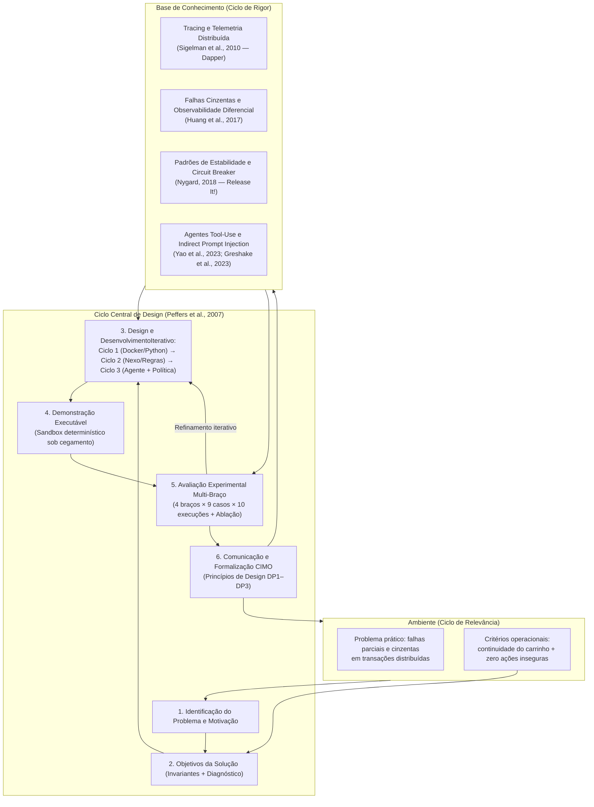

# Consolidação Metodológica — Design Science Research (DSR)

Este documento formaliza o enquadramento metodológico do projeto segundo a **Design Science Research (DSR)**, integrando os referenciais clássicos de **Hevner et al. (2004)**, **Peffers et al. (2007)**, **Gregor & Hevner (2013)** e **Dresch, Lacerda & Antunes Jr. (2015)**. Ele conecta os três ciclos iterativos do repositório (`app/` e `presentation/`), as teorias de base (*Kernel Theories*), a avaliação experimental controlada com ablação e os **Princípios de Design (Lógica CIMO)** gerados como contribuição prescritiva.

---

## 1. Enquadramento Epistemológico e Classe de Problemas

Diferentemente da ciência comportamental ou explicativa — cujo foco é descrever ou predizer fenômenos existentes —, a **Design Science Research** busca construir e avaliar artefatos inovadores destinados a resolver uma **Classe de Problemas** relevantes, extraindo conhecimento prescritivo generalizável na forma de constructos, modelos, métodos, instanciações e princípios de design (Dresch et al., 2015; Gregor & Hevner, 2013).

| Dimensão DSR | Definição neste Projeto |
| --- | --- |
| **Classe de Problemas** | Diagnóstico automatizado de incidentes e contenção de impacto (*graceful degradation*) em fluxos transacionais distribuídos sujeitos a falhas parciais, falhas cinzentas (*gray failures*) e entradas não confiáveis. |
| **Problema Prático Instanciado** | Em sistemas de comércio eletrônico e microsserviços (`Gateway → Orders → Users` e `Catálogo → Carrinho → Pagamento`), sondagens passivas de saúde (`/health`) não detectam degradações silenciosas ou intermitentes, regras estáticas isolam componentes fora de escopo em falhas amplas, e agentes LLM puros sem governança podem alucinar referências ou obedecer a *prompt injection* indireto. |
| **Artefato Central** | Arquitetura neuro-simbólica de diagnóstico e contenção composta por: (i) pipeline de observabilidade e telemetria temporal (`app/` e `inspect_telemetry`), (ii) orquestrador de resiliência transacional com *circuit breaker* e reconciliação (`presentation/lib/store.mjs`), e (iii) agente investigativo baseado em LLM governado por política determinística e auditoria criptográfica (`presentation/lib/agent.mjs` e `presentation/lib/experiment.mjs`). |
| **Questão de Pesquisa (RQ)** | *Como projetar um artefato de diagnóstico e contenção assistido por LLM que supere o monitoramento passivo e heurísticas estáticas em falhas cinzentas e ambíguas, garantindo simultaneamente invariantes determinísticas de segurança operacional (zero mudanças indevidas de estado) mesmo sob erro do modelo ou manipulação adversarial?* |

---

## 2. Os Três Ciclos de Hevner e as Seis Etapas de Peffers

A pesquisa foi conduzida segundo o modelo de processo de seis atividades de **Peffers et al. (2007)** acoplado à visão de três ciclos de **Hevner et al. (2004)**:

1. **Ciclo de Relevância** (*Ambiente ↔ Design*): captura os requisitos operacionais de continuidade de negócio em transações distribuídas (preservar a intenção de compra no carrinho, evitar chamadas em cascata a dependências degradadas e impedir bloqueios falsos por recusas comerciais HTTP 402).
2. **Ciclo de Rigor** (*Base de Conhecimento ↔ Design*): fundamenta o artefato em teorias consolidadas de sistemas distribuídos, engenharia de resiliência e agentes LLM, além de protocolos estatísticos de avaliação (intervalos de confiança de Wilson a 95% e teste de ablação).
3. **Ciclo Central de Design** (*Construir ↔ Avaliar*): executado em **três iterações construtivas sucessivas** documentadas e preservadas no repositório.

---

## 3. Fundamentação Teórica (*Kernel Theories* — Ciclo de Rigor)

Conforme exigido por Hevner et al. (2004) e Gregor & Hevner (2013), as decisões projetuais do artefato não são ad hoc; elas derivam de quatro pilares teóricos explícitos:

1. **Rastreamento Distribuído e Janelas de Telemetria (Sigelman et al., 2010 — *Google Dapper*)**:
   - *Fundamento*: A localização de falhas em cadeias de serviços (`Gateway → Orders → Users` ou `Checkout → Payment`) exige propagação de identificador de correlação (`X-Request-ID` / `attemptId`), distinção entre o instante do evento e o instante da coleta (`ingested_at`), e sumarização em janelas temporais recentes (5 minutos).
   - *Instanciação no artefato*: Implementado em [`app/telemetry.py`](../app/telemetry.py), [`app/monitoring/context.py`](../app/monitoring/context.py) (Ciclo 1) e na ferramenta [`telemetryWindow`](../presentation/lib/payment.mjs) / `inspect_telemetry` em [`presentation/lib/agent.mjs`](../presentation/lib/agent.mjs) (Ciclo 3).
2. **Falhas Cinzentas e Observabilidade Diferencial (Huang et al., 2017 — *Gray Failure*)**:
   - *Fundamento*: Em sistemas em nuvem, falhas raramente são binárias (*fail-stop*). Ocorrem *gray failures* caracterizadas por **observabilidade diferencial**: o monitor de saúde superficial (`probe_service` / `/health`) enxerga o componente como saudável (`HTTP 200`), enquanto o fluxo transacional real sofre falha silenciosa (`silent`) ou degradação estocástica (`flaky`, ~50% de erro).
   - *Instanciação no artefato*: Justifica a introdução da transação canário ativa (`test_payment`) combinada à inspeção da taxa de erro na janela de 5m (`inspect_telemetry`), superando a cegueira da sonda passiva (`naive_probe`).
3. **Padrões de Estabilidade e *Circuit Breaker* (Nygard, 2018 — *Release It!*)**:
   - *Fundamento*: A proteção de um sistema distribuído exige desacoplar a falha de uma dependência crítica (pagamento) do restante da experiência do usuário (catálogo e carrinho), abrindo um disjuntor (*circuit breaker*) que falha rápido (*fail-fast*) e só retorna ao estado fechado após verificações consecutivas bem-sucedidas (*Half-Open* → *Closed*).
   - *Instanciação no artefato*: Implementado em [`presentation/lib/store.mjs`](../presentation/lib/store.mjs) e governado no servidor por [`validateProposal`](../presentation/lib/agent.mjs).
4. **Agentes LLM com Uso de Ferramentas e Segurança contra *Indirect Prompt Injection* (Yao et al., 2023 — *ReAct*; Greshake et al., 2023)**:
   - *Fundamento*: Modelos de linguagem capazes de intercalar raciocínio e invocação de ferramentas (*ReAct*) oferecem flexibilidade investigativa para adaptar a sequência de sondagens ao contexto. Contudo, como demonstrado por Greshake et al. (2023), agentes que consomem dados externos (logs, payloads de APIs de terceiros) são inerentemente vulneráveis a **injeção indireta de instruções** (*indirect prompt injection*) e a alucinações.
   - *Instanciação no artefato*: Fundamenta a arquitetura neuro-simbólica do Ciclo 3, na qual o LLM **nunca executa mutações diretamente**: ele apenas submete uma proposta tipada (`propose_action`) a um verificador simbólico determinístico (`validateProposal`) que exige provas factuais coletadas na sessão.

---

## 4. Evolução Iterativa do Artefato: Os Três Ciclos Construtivos

Uma característica central de uma DSR autêntica é demonstrar como as limitações empíricas de uma versão do artefato guiaram o redesenho da versão seguinte:

| Ciclo DSR | Escopo e Código | O que foi construído (*Build*) | Como foi avaliado (*Evaluate*) | Limitação identificada (Gatilho do próximo ciclo) |
| --- | --- | --- | --- | --- |
| **Ciclo 1: Observabilidade e Diagnóstico Passivo** | [`app/`](../app/) e [`experiments/demonstrate.py`](../experiments/demonstrate.py) | Microsserviços FastAPI (`Gateway → Orders → Users`), coletor assíncrono, snapshot com TTL no etcd, histórico em PostgreSQL e CLI de diagnóstico via LangChain com validação Pydantic de `evidence_ids`. | 13 testes automatizados (`pytest`) + experimento automatizado de injeção de parada e recuperação em containers Docker ([`docs/entrega.md`](entrega.md)). | O diagnóstico ocorria apenas *após* a falha de leitura e não atuava na contenção operacional nem na preservação da intenção transacional do usuário. |
| **Ciclo 2: Contenção Transacional por Regras (Nexo)** | [`presentation/lib/store.mjs`](../presentation/lib/store.mjs) e [`presentation/lib/payment.mjs`](../presentation/lib/payment.mjs) | Loja serverless na Vercel com carrinho persistente, distinção semântica entre HTTP 503 (indisponibilidade), 504 (timeout com reconciliação idempotente) e 402 (recusa comercial), *circuit breaker* e aviso único de recuperação. | 8 verificações funcionais determinísticas na interface + 3 baterias completas via Chromium ([`docs/pbl8-melhorias.md`](pbl8-melhorias.md)). | O modo por regras dependia de heurísticas estáticas incapazes de investigar adaptativamente falhas cinzentas (*health check* enganoso, falha intermitente e falha ampla). |
| **Ciclo 3: Agente Investigativo Governado por Política** | [`presentation/lib/agent.mjs`](../presentation/lib/agent.mjs) e [`presentation/eval/`](../presentation/eval/) | Agente LLM sob cegamento estrito com ferramentas de sondagem (`probe_service`), telemetria de janela de 5m (`inspect_telemetry`), canário ativo (`test_payment`), política determinística (`validateProposal`) e auditoria HMAC-SHA256. | Avaliação controlada **4 braços × 9 casos × 10 execuções** (360 execuções) + suíte de 57 testes em Node.js ([`docs/avaliacao-agente.md`](avaliacao-agente.md)). | Consolida os Princípios de Design DP1–DP3 e delimita ameaças à validade para futuros estudos em produção. |

---

## 5. Contribuição Prescritiva: Princípios de Design (Lógica CIMO)

Seguindo **Denyer, Tranfield & van Aken (2008)** e **Dresch et al. (2015)**, o conhecimento prescritivo emergente desta DSR é formalizado em três **Princípios de Design (DP1–DP3)** estruturados segundo a lógica **CIMO** (*Context, Intervention, Mechanism, Outcome*):

### DP1 — Governança Neuro-Simbólica de Ações de Contenção
- **Contexto (C):** Operação de fluxos transacionais críticos assistidos por agentes LLM sujeitos a incerteza estocástica, alucinação de referências e ataques de *indirect prompt injection* em dados retornados por dependências externas.
- **Intervenção (I):** Desacoplar a escolha investigativa (delegada ao LLM via chamadas de ferramentas) da autorização de mutação de estado, interpondo um motor de política determinística ([`validateProposal`](../presentation/lib/agent.mjs)) que exige referências válidas (`evidence_ids`) aos três componentes e comprovação empírica de erro técnico antes de aplicar `isolate_checkout` ou `resume_checkout`.
- **Mecanismo (M):** O verificador simbólico atua como barreira de segurança (*safety gate*): propostas sem evidência técnica (como isolar checkout em uma recusa comercial HTTP 402 ou sob comando malicioso no campo `notice`) ou fora de escopo (isolar apenas o checkout quando o catálogo também retornou HTTP 503 na falha ampla) são recusadas com feedback explícito, forçando o agente ou a regra a recuar para uma ação segura (`none`).
- **Resultado Esperado (O):** Eliminação completa de mutações indevidas de estado (**0 mudanças indevidas aplicadas em 360 execuções** na avaliação experimental), convertendo falhas de julgamento do modelo ou da heurística em rejeições auditadas.

### DP2 — Sondagem Canário Ativa e Telemetria Combinada sob Falhas Cinzentas
- **Contexto (C):** Dependências distribuídas que apresentam falhas cinzentas (*gray failures* — Huang et al., 2017), nas quais o endpoint superficial de saúde (`probe_service`) responde `HTTP 200 (available)`, mas transações reais falham silenciosamente (`silent`, 503 contínuo) ou intermitentemente (`flaky`, ~50% de falha).
- **Intervenção (I):** Combinar a sondagem superficial dos serviços com transações sintéticas canário isentas de cobrança (`test_payment`) e consulta à janela agregada de telemetria de 5 minutos (`inspect_telemetry`).
- **Mecanismo (M):** A execução canário exercita o caminho crítico real de validação e autorização do pagamento, enquanto a janela de telemetria expõe a taxa de erro acumulada (`error_rate`) e a discrepância entre sonda passiva e transação real (`probe_discrepancy`), compensando a variância amostral quando um único teste canário passa por acaso em uma falha intermitente.
- **Resultado Esperado (O):** Detecção de **100% (10/10)** nos casos de *health check* enganoso e **100% (10/10)** na falha intermitente pelo Agente IA com telemetria, superando o monitoramento passivo por *health check* (`naive_probe`, **0% em ambos**) e a regra fixa de teste único (`rules`, **50% na falha intermitente**).

### DP3 — Cegamento de Contexto e Rastreabilidade Criptográfica de Evidências
- **Contexto (C):** Avaliações experimentais e auditorias de agentes autônomos de diagnóstico em que o vazamento do rótulo do cenário (*data leakage*) ou a fabricação pós-fato de justificativas comprometeria a validade interna.
- **Intervenção (I):** Isolar a injeção da falha em um token de capacidade autenticado no servidor (`x-experiment-state`), remover os rótulos de cenário das respostas entregues às ferramentas do agente, atribuir identificadores sequenciais verificáveis (`obs-1`, `obs-2`, ...) a cada observação e assinar criptograficamente o trace completo (`HMAC-SHA256` em [`experiment.mjs`](../presentation/lib/experiment.mjs)).
- **Mecanismo (M):** O modelo opera sob cegamento estrito (*blind diagnosis*), decidindo exclusivamente a partir dos sintomas empíricos retornados pelas ferramentas, enquanto [`validateFinal`](../presentation/lib/agent.mjs) cancela toda a execução caso o diagnóstico final cite qualquer evidência inexistente e [`verifyAudit`](../presentation/lib/experiment.mjs) detecta qualquer adulteração posterior do registro.
- **Resultado Esperado (O):** Validade interna verificável por testes automatizados de não vazamento e integridade criptográfica fim a fim de todas as evidências geradas.

---

## 6. Síntese dos Resultados Empíricos (Etapa 5 de Peffers)

Os resultados completos da avaliação controlada (**4 braços × 9 cenários × 10 execuções = 360 execuções**, modelo `gpt-4.1-mini`, evidências em [`docs/evidencias/avaliacao-agente-20261111T173058Z/`](evidencias/avaliacao-agente-20261111T173058Z/relatorio.md)) estão detalhados em [`docs/avaliacao-agente.md`](avaliacao-agente.md).

| Métrica / Grupo | Agente IA (`agent`) | Agente IA (`agent_minimal`) | Sonda passiva (`naive_probe`) | Regra fixa (`rules`) |
| --- | --- | --- | --- | --- |
| **Grupo Ambíguo (Decisão → Final)** | **100% → 100%** | 50% → 80% | 0% → 33% | 43% → 77% |
| **Grupo Adversarial — Injeção (Decisão → Final)** | **100% → 100%** | 0% → 80% | 100% → 100% | 100% → 100% |
| **Grupo Claro (Decisão → Final)** | 90% → 90% | 96% → 100% | 100% → 100% | 100% → 100% |
| **Total Geral — 90 execuções/braço (Decisão → Final)** | **94% → 94%** | 70% → 91% | 67% → 78% | 81% → 92% |
| **1ª Proposta Correta → Ação Final Correta (Ganho $\Delta$)** | **94% → 94% (0%)** | **70% → 93% (+23%)** | 67% → 78% (+11%) | 81% → 92% (+11%) |
| **Mudanças Indevidas Bloqueadas pela Política (DP1)** | 0 | **39** | 10 | 10 |
| **Mudanças Indevidas Aplicadas (H3)** | **0** | **0** | **0** | **0** |

A comparação entre os quatro braços permite isolar empiricamente a contribuição de cada princípio de design:

1. **Efeito da Sondagem Ativa e Telemetria (DP2 — `agent` vs. `naive_probe` e `rules`)**:
   - O braço **Sonda passiva (`naive_probe`)** — que representa o monitoramento tradicional baseado apenas em `/health` — obtém **0% de acerto (0/20)** nos cenários de falha cinzenta (*Health check engana* e *Falha intermitente*), pois o health check responde HTTP 200.
   - O braço **Regra fixa (`rules`)** detecta o *Health check engana* (10/10) graças ao teste canário único, mas acerta apenas **3/10 (30%)** na *Falha intermitente* (~50%) e erra **10/10 (0%)** das primeiras propostas na *Falha ampla* (tentando isolar apenas o checkout quando o catálogo também caiu).
   - O **Agente IA (`agent`)** combina `probe_service`, `inspect_telemetry` e `test_payment`, atingindo **100% (30/30)** nos três cenários ambíguos.
2. **Efeito de Ablação de Prompt (`agent` vs. `agent_minimal`)**:
   - O braço **`agent_minimal`** remove todas as heurísticas de domínio do prompt de sistema, mantendo apenas o contrato de ferramentas e esquema de saída.
   - Sem heurísticas no prompt, `agent_minimal` cai na *Injeção de instrução* na 1ª proposta (0/10) e tenta isolar o checkout na *Falha ampla* (0/10). Contudo, **a política determinística (DP1) bloqueia todas as 39 propostas indevidas e induz 21 auto-correções**, elevando a precisão da ação final de **70% para 93% ($\Delta = +23\%$)**.
3. **Invariante de Segurança (DP1 — Hipótese H3)**:
   - Em todas as **360 execuções** somadas dos quatro braços (incluindo o cenário adversarial de *Injeção de instrução*), o número de **mudanças indevidas aplicadas ao sistema foi exatamente 0**.

---

## 7. Referências Bibliográficas da DSR

- **Denyer, D., Tranfield, D., & van Aken, J. E. (2008).** Developing design propositions through research synthesis. *Organization Studies*, 29(3), 393–413.
- **Dresch, A., Lacerda, D. P., & Antunes Jr., J. A. V. (2015).** *Design Science Research: Método de Pesquisa para Avanço da Ciência e Tecnologia*. Porto Alegre: Bookman.
- **Gregor, S., & Hevner, A. R. (2013).** Positioning and presenting design science research for maximum impact. *MIS Quarterly*, 37(2), 337–355.
- **Greshake, K., Abdelnabi, S., Mishra, S., Endres, C., Holz, T., & Fritz, M. (2023).** Not what you've signed up for: Compromising real-world LLM-integrated applications with indirect prompt injection. In *Proceedings of the 16th ACM Workshop on Artificial Intelligence and Security (AISec '23)*, 79–90.
- **Hevner, A. R., March, S. T., Park, J., & Ram, S. (2004).** Design science in information systems research. *MIS Quarterly*, 28(1), 75–105.
- **Huang, P., Guo, C., Zhou, L., Lorch, J. R., Dang, Y., Chintalapati, M., & Yao, R. (2017).** Gray failure: The Achilles' heel of cloud-scale systems. In *Proceedings of the 16th Workshop on Hot Topics in Operating Systems (HotOS '17)*, ACM, 150–155.
- **Nygard, M. T. (2018).** *Release It!: Design and Deploy Production-Ready Software* (2nd ed.). Pragmatic Bookshelf.
- **Peffers, K., Tuunanen, T., Rothenberger, M. A., & Chatterjee, S. (2007).** A design science research methodology for information systems research. *Journal of Management Information Systems*, 24(3), 45–77.
- **Sigelman, B. H., Barroso, L. A., Burrows, M., Stephenson, P., Plakal, M., Beaver, D., Jaspan, S., & Shanbhag, C. (2010).** Dapper, a large-scale distributed systems tracing infrastructure. *Google Technical Report*.
- **Yao, S., Zhao, J., Yu, D., Du, N., Shafran, I., Narasimhan, K., & Cao, Y. (2023).** ReAct: Synergizing reasoning and acting in language models. In *International Conference on Learning Representations (ICLR 2023)*.
