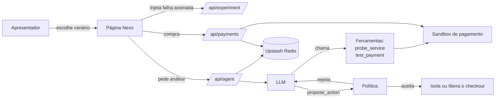

# Guia do projeto

Este é o ponto de partida para entender o projeto, executá-lo e apresentá-lo.
Os detalhes ficam nos documentos linkados em cada seção.

## 1. O que é

Um artefato de pesquisa aplicada (Design Science Research) sobre **diagnóstico de
falhas em sistemas distribuídos com apoio de LLM**. Ele tem duas versões:

| | Versão 1 — Diagnóstico (Docker) | Versão 2 — Nexo (Vercel) |
| --- | --- | --- |
| Cenário | Consulta de pedido Gateway → Orders → Users | Loja com catálogo, carrinho e pagamento sandbox |
| Tecnologia | Python, FastAPI, PostgreSQL, etcd, LangChain | Node.js sem dependências, funções serverless |
| Papel da IA | Lê logs e métricas e escreve um diagnóstico com evidências | **Agente**: escolhe verificações, propõe uma ação e a política valida |
| Precisa de | Docker e chave de LLM | Só Node.js (a IA é opcional) |

A **versão 2 é a que se apresenta**. A versão 1 continua no repositório como o
ciclo anterior da pesquisa.

**Pergunta de pesquisa (ciclo atual):** em falhas cujo sinal é ambíguo, um agente
LLM que escolhe as próprias verificações decide melhor que uma regra fixa, sem
aplicar mudanças indevidas ao sistema?

## 2. Como funciona a versão 2



1. O apresentador injeta uma falha (por exemplo, "Falha intermitente"). O nome
   do cenário fica num token assinado e **não é enviado ao modelo**.
2. O agente investiga com ferramentas: sonda catálogo, carrinho e pagamento, e
   faz compras canário (`test_payment`), sem cobrança.
3. O agente propõe uma ação: isolar o checkout, liberar ou não mexer. Ele cita
   os IDs das evidências.
4. A **política** confere se as evidências sustentam a ação. Só então ela é aplicada.
5. Tudo fica num trace visível na página, assinado e, se o Upstash estiver
   configurado, salvo no servidor.

**O que o agente não faz:** não corrige código, não reinicia serviços, não faz
deploy e não detecta quedas reais da Vercel. Ele diagnostica e contém o impacto
dentro de um sandbox controlado.

## 3. Estrutura de pastas

```text
presentation/                 Versão 2 (Nexo)
  api/                        Funções serverless: payments, experiment, agent, diagnose, logs
  lib/agent.mjs               Agente: ferramentas, laço de execução e política
  lib/payment.mjs             Sandbox de pagamento e cenários de falha
  lib/log.mjs                 Logs no Upstash Redis
  lib/store.mjs               Carrinho, circuito e regras (roda no navegador)
  eval/                       Avaliação agente × regra fixa
  tests/                      Testes (node --test)
  page.html, store.mjs, store.css   Interface; build.mjs gera index.html
  dev.mjs                     Servidor local com os mesmos handlers da Vercel
app/                          Versão 1 (Python): microsserviços, coleta e diagnóstico
experiments/demonstrate.py    Demonstração automatizada da versão 1
docs/                         Documentação e evidências
```

## 4. Como rodar

### Pré-requisitos

- **Node.js 22** ou mais novo (`node --version`).
- Para o modo Agente IA: uma chave de API de um provedor compatível com
  Chat Completions e ferramentas (o projeto usa `gpt-4.1-mini` da OpenAI).
- Só para a versão 1: Python 3.12 e Docker Desktop.

### 4.1 Modo Regras, sem IA (5 minutos)

Não precisa de chave nem de configuração.

```bash
cd presentation
node build.mjs
node --test tests/*.test.mjs
node dev.mjs
```

Abra <http://localhost:3100>. Para usar outra porta, defina `PORT` antes de
`node dev.mjs`. Os testes devem terminar com `fail 0`.

O que dá para fazer: adicionar produtos ao carrinho, escolher cenários, ver o
circuito abrir e fechar, rodar os **Testes funcionais (8)** e exportar o relatório JSON.

### 4.2 Modo Agente IA, local

1. No arquivo `.env` da raiz do repositório, preencha a chave e crie uma senha
   para o apresentador. A senha precisa ter pelo menos 32 caracteres. Para gerar uma:

   ```bash
   node -e "console.log(require('crypto').randomBytes(24).toString('hex'))"
   ```

   ```dotenv
   OBS_LLM_URL=https://api.openai.com/v1
   OBS_LLM_MODEL=gpt-4.1-mini
   OBS_LLM_API_KEY=sua-chave
   OBS_DEMO_TOKEN=senha-gerada-acima
   ```

2. Inicie o servidor carregando o `.env`:

   ```bash
   cd presentation
   node --env-file=../.env dev.mjs
   ```

3. Na página, abra **Usar IA**, digite a senha em **Senha de acesso** e clique em
   **Ativar IA**. A partir daí, cada cenário escolhido chama o agente. O trace
   aparece em **Ver ações da IA**.

A senha não fica salva: depois de recarregar a página, é preciso ativar a IA de
novo. **Desativar IA** volta ao modo Regras.

### 4.3 Avaliação agente × regra fixa

Gera as tabelas de resultado que vão para o trabalho:

```bash
cd presentation
node --env-file=../.env eval/run.mjs --runs 10
```

São cerca de 90 execuções do agente, com chamadas pagas ao provedor. Para testar
o script sem custo, rode só a regra fixa:

```bash
node eval/run.mjs --arms rules --runs 3
```

O resultado fica em `docs/evidencias/avaliacao-agente-<data>/relatorio.md`. O
protocolo completo está em [avaliacao-agente.md](avaliacao-agente.md).

### 4.4 Publicar na Vercel

1. Importe o repositório na Vercel com **Root Directory** `presentation`,
   Framework **Other**, Build `node build.mjs`, Output `public` e Install vazio.
2. Em **Settings → Environment Variables**, cadastre `OBS_LLM_URL`,
   `OBS_LLM_MODEL`, `OBS_LLM_API_KEY` e `OBS_DEMO_TOKEN`.
3. Para salvar os logs no servidor: **Storage → Upstash for Redis**, vincule ao
   projeto e faça um novo deploy.
4. Teste o deploy: compra normal, um cenário de falha, e `/api/logs` com o token.

Passo a passo e conferência do deploy: [vercel.md](vercel.md).

### 4.5 Versão 1 (Docker), se o professor pedir

Com Docker em execução e o `.env` configurado:

```powershell
docker compose up --build -d --wait
Invoke-RestMethod http://localhost:8000/orders/1 -Headers @{ 'X-Request-ID' = 'req-demo-123' }
docker compose run --rm --no-deps diagnostics diagnose --service gateway --request-id req-demo-123
```

A demonstração automatizada (sucesso → queda de Users → recuperação) é
`python -B experiments/demonstrate.py`. Os detalhes estão no [README](../README.md#executar).

## 5. Roteiro de apresentação (10–12 minutos)

### Antes da aula

- [ ] Chave da LLM válida. Teste com `node --env-file=../.env eval/run.mjs --runs 1 --cases outage`.
- [ ] Avaliação rodada com `--runs 10` e `relatorio.md` aberto.
- [ ] Seção 4 de [avaliacao-agente.md](avaliacao-agente.md) preenchida com os números do relatório.
- [ ] Página aberta (local ou Vercel), carrinho vazio e IA ainda **desativada**.
- [ ] Senha `OBS_DEMO_TOKEN` à mão.

### Na aula

| Tempo | O que mostrar | Mensagem |
| --- | --- | --- |
| 1 min | Problema e pergunta de pesquisa (seção 1) | Uma regra fixa resolve casos claros; a dúvida é nos ambíguos |
| 2 min | Modo Regras: compra normal, depois *Falha no pagamento* | O carrinho é preservado e o circuito protege a compra |
| 2 min | Ainda em Regras: *Health check engana* | A sondagem diz "disponível" e o checkout continua liberado; a regra não percebe |
| 3 min | Ativar IA e repetir *Health check engana*, depois *Falha intermitente* duas vezes | Mostrar no trace a compra canário e quantas vezes o agente testa; comparar o caminho das duas execuções |
| 1 min | *Falha ampla* e *Injeção de instrução* | Mostrar se o agente isola ou não, o texto injetado no resultado da ferramenta e, se ele errar, a política rejeitando |
| 1 min | **Verificar registro** e `/api/logs` | Cada decisão é rastreável e a assinatura detecta alterações |
| 2 min | Tabela do `relatorio.md` | Agente × regra fixa com intervalos de confiança, incluindo os erros do agente |

O roteiro detalhado, com as falas, as perguntas prováveis e o que não afirmar,
está na seção 6 de [avaliacao-agente.md](avaliacao-agente.md#6-roteiro-para-a-apresentação).

## 6. Documentos do projeto

| Documento | Para quê |
| --- | --- |
| [avaliacao-agente.md](avaliacao-agente.md) | Protocolo da avaliação, hipóteses, ameaças à validade e roteiro |
| [agente-ia.md](agente-ia.md) | Como o agente e a política funcionam |
| [vercel.md](vercel.md) | Publicação, variáveis e logs no servidor |
| [pbl8-melhorias.md](pbl8-melhorias.md) | Ciclo anterior: loja, circuito e aviso de recuperação |
| [pjbl3-artefato.md](pjbl3-artefato.md) | Construção do artefato e evidências da versão 2 |
| [caso-de-uso.md](caso-de-uso.md) | Caso de uso da versão 1 |
| [entrega.md](entrega.md) e [o-que-foi-feito.md](o-que-foi-feito.md) | Entregas da versão 1 |
| [estado-da-implementacao.md](estado-da-implementacao.md) | Estado e limites da versão 1 |
| `evidencias/` | Registros de cada execução, sem sobrescrever os anteriores |

## 7. Problemas comuns

| Sintoma | Causa provável | O que fazer |
| --- | --- | --- |
| "Configure o provedor de IA na Vercel" ou IA indisponível | Falta alguma variável `OBS_LLM_*` ou `OBS_DEMO_TOKEN` (ou a senha tem menos de 32 caracteres) | Conferir o `.env` (local) ou as variáveis da Vercel e reiniciar o servidor ou refazer o deploy |
| "Token do apresentador inválido" | Senha digitada diferente de `OBS_DEMO_TOKEN` | Copiar a senha de novo, sem espaços |
| A análise do agente falha e nenhuma ação é aplicada | O provedor recusou a chamada (chave inválida, sem crédito, modelo errado) | Testar com `eval/run.mjs --runs 1 --cases outage`; trocar a chave se necessário |
| Avaliação mostra `provider_failed` em tudo | Mesma causa acima | Idem |
| `/api/payments` devolve HTML ou 404 na Vercel | Root Directory errado ou funções não publicadas | Root Directory `presentation` e build pelo `vercel.json` |
| `/api/logs` responde 503 `configured: false` | Upstash não vinculado | Vincular o Upstash e refazer o deploy |
| Porta 3100 ocupada | Outro processo usando a porta | Definir `PORT=3200` antes de `node dev.mjs` |
| Página mostra estado antigo (carrinho, circuito) | Estado salvo no navegador | Limpar os dados do site no navegador ou abrir uma janela anônima |

## 8. Limites

- As falhas são simuladas num sandbox. Isso é necessário para saber a resposta
  certa e medir acerto, mas não representa produção.
- O pagamento é de teste; nenhuma cobrança acontece.
- Amostra pequena (N = 10 por caso) e um único modelo.
- As instruções do agente foram escritas por quem conhecia os cenários.
- A lista completa de ameaças à validade está em
  [avaliacao-agente.md](avaliacao-agente.md#5-ameaças-à-validade).
